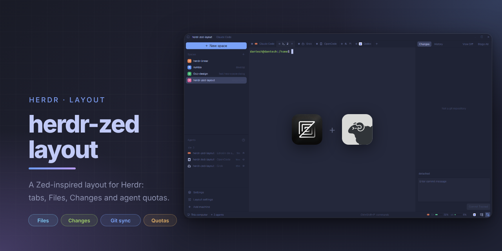

# herdr-zed-layout



Layout para [Herdr](https://github.com/herdrdev/herdr-app) inspirado en Zed. Reúne una barra de título, navegación por pestañas, paneles Files y Changes, barra de estado, configuración del layout y cuotas de agentes.

## Qué incluye

El layout `zed` usa el tema Tokyo Night, JetBrains Mono a 14 px para el contenido y Geist para la interfaz. Tiene una barra lateral de 300 px (ajustable entre 44 y 560 px), panel derecho inicialmente oculto y una barra de estado con cuota y selectores de panel.

Los mods de Herdr que consume directamente son `spaces`, `agents`, `workspace-status` y, al crear un space con rama, `worktree`.

### Mods propios

| Mod | Funcionalidad |
| --- | --- |
| `zed-title` | Barra de título con breadcrumbs del space, rama y agente o pestaña; permite mostrar u ocultar la barra lateral y muestra controles de ventana cuando Herdr los expone. Ajusta el espacio de los controles de macOS. |
| `zed-tabs` | Pestañas estilo Zed: seleccionar, cerrar, renombrar con doble clic, reordenar por arrastre, menú contextual, navegación con rueda e iconos para archivos. Conserva por space el panel derecho elegido (`files` o `changes`). |
| `zed-new-space` | Botón y diálogo para crear spaces con carpeta, agente instalado, máquina activa o remota y rama opcional. Con rama abre el flujo de worktree; sin rama crea el space. Usa la carpeta del panel enfocado como valor inicial local. |
| `zed-sidebar-footer` | Accesos a Settings de Herdr —con indicador de actualización—, Layout settings y Add machine. |
| `zed-settings` | Ajustes con búsqueda y categorías **Editor**, **Quota bar** y **Providers**. Configura wrap global para nuevas pestañas, editor preferido, visualización de cuotas, ventanas, proveedores y límites de Antigravity. |
| `zed-panel-switch` | Botones Files y Changes en la barra de estado; cambian el panel derecho o lo ocultan si ya está activo. |
| `zed-file-icons` | Navegador Files con iconos, expansión de carpetas y apertura de archivos en pestañas `zed-file`. Omite `.git` y limita una lectura de directorio a 501 entradas. |
| `zed-file` | Pestañas de archivo de **solo lectura**, con resaltado, números de línea, recarga al cambiar el directorio y soft-wrap por pestaña (`Alt-Z` o control de wrap). Detecta binarios/no disponibles y limita el texto a 400.000 caracteres. Permite abrir el archivo local con el editor gráfico elegido; Zed es el predeterminado si está instalado. No ofrece esta acción para archivos remotos ni en Windows. |
| `zed-diff` | Pestaña de diff de **solo lectura**: números de línea de ambos lados, filas verdes/rojas, colores de sintaxis y recarga al cambiar la carpeta, word wrap con el botón `wrap` o `Alt+Z` (hasta 4000 filas). |
| `zed-changes` | Panel Git: estado, stage/unstage por archivo, stage all, commit de cambios ya staged, historial de 30 commits. Al hacer clic en un archivo cambiado, su diff se abre en una pestaña propia (`zed-diff`). El clic derecho abre un menú con Stage/Unstage File, Discard Changes (con confirmación), Copy Path, Copy Relative Path, Add to .gitignore, Add to .git/info/exclude (solo archivos nuevos), Open Diff y View File. Incluye búsqueda, cambio, creación y borrado de ramas locales, ramas remotas y protección al borrar ramas con commits no publicados. También incorpora Fetch, Fetch From, Pull, Pull (Rebase), Push, Push To y Force Push con `--force-with-lease` y confirmación. La acción principal se adapta a Publish, Pull, Push o Fetch. Con [`gh`](https://cli.github.com) instalado y autenticado, un botón **Create PR** (cualquier rama que no sea la predeterminada y no tenga un PR abierto) abre un diálogo con título y descripción tomados del último commit y opción Draft; publica la rama si hace falta y ejecuta `gh pr create`. Si la rama ya tiene un PR abierto, el botón pasa a **View PR** y lo abre en el navegador (en máquinas remotas copia la URL). Sin `gh` el botón no aparece. Se actualiza cada 10 s y vigila la carpeta local. No lista un repositorio ubicado en el directorio personal ni uno con más de 5.000 cambios. |
| `zed-commands` | Comandos rápidos por proyecto, como en Orca. Botón `▶ etiqueta ▾` a la derecha de la barra de pestañas: el botón ejecuta el último comando usado (o el primero) y `▾` abre el menú con ejecutar, copiar, editar y borrar, más `+ Command`. El diálogo pide Label, Action (Terminal o Agent) y Command. Se guardan por carpeta del space en la clave compartida `zed-commands.items`. Terminal abre una pestaña nueva con el nombre del comando y deja un shell abierto al terminar; Agent abre el agente elegido con el texto como primer mensaje. No hay opción «Append Enter»: Herdr no permite enviar texto a un terminal existente. |
| `zed-quota` | Barras de cuota basadas en `quota-axi --json`, con detalle, refresco y acceso a Settings. Se actualizan cada 120 s y se consideran obsoletas después de 10 min. Soporta máquinas remotas, `percentRemaining` y la ejecución mediante `cmd.exe` en Windows o shell de login en Unix. |

## Configuración

La configuración fija del layout está en [`layouts/zed.json`](layouts/zed.json):

- El panel derecho contiene Files y Changes, mide 320 px por defecto (220–640 px) y empieza oculto.
- La barra de estado reserva 400 px para cuota y 64 px para sus selectores de panel.
- Las cuotas ocultan inicialmente `cursor` y `copilot`; para `grok` muestran únicamente la ventana `credits`. La prop `windows` filtra la barra, no el popup de detalle.
- Los valores elegidos desde **Layout settings** se mantienen como estado compartido de la sesión. Este repositorio no demuestra que persistan entre reinicios.

## Requisitos

Opcional: [`gh`](https://cli.github.com) autenticado (`gh auth login`) para crear y ver PR desde el panel Changes.

Las barras de cuota necesitan [`quota-axi`](https://github.com/kunchenguid/quota-axi):

```bash
npm install -g quota-axi
quota-axi --json
```

El segundo comando debe responder correctamente. Cada proveedor consulta el uso con las credenciales ya disponibles en la máquina.

## Instalación y actualización

```bash
./install.sh
herdr-app do layout.switch --name zed
```

El instalador crea enlaces simbólicos para `layouts/zed.json`, `layouts/zed.svg` y `themes/tokyo-night.json` dentro de `${HERDR_APP_HOME:-$HOME/.config/herdr-app}`. Los mods se copian como archivos reales porque Herdr no sirve assets mediante enlaces ni permite imports que resuelvan fuera de la carpeta del mod.

Después de cambiar cualquier archivo de `mods/`, ejecuta `./install.sh` de nuevo. Si un destino de mod es un enlace, el script lo sustituye; esto es relevante si mantienes una instalación personalizada.

Para comprobar los manifiestos de los mods:

```bash
for m in mods/zed-{title,tabs,commands,new-space,sidebar-footer,settings,panel-switch,file-icons,file,changes,quota}/; do
  herdr-app check "$m"
done
```

## Créditos y licencias

- **`mods/zed-file-icons`** parte de [`amster93/herdr-file-icons`](https://github.com/amster93/herdr-file-icons), distribuido bajo Apache-2.0. A su vez se basa en el mod `files` de Herdr. En este repositorio se eliminó la tarjeta redondeada con borde que envolvía la raíz del panel. Conserva [`LICENSE`](mods/zed-file-icons/LICENSE), [`LICENSE-Lucide.txt`](mods/zed-file-icons/LICENSE-Lucide.txt) y [`LICENSE-material-icon-theme.txt`](mods/zed-file-icons/LICENSE-material-icon-theme.txt).
  - Sus 1.184 iconos provienen de [Material Icon Theme](https://github.com/material-extensions/vscode-material-icon-theme), bajo MIT (© Material Extensions).
  - Algunos iconos atribuidos a Lucide/Feather están cubiertos por los avisos de licencia incluidos en el mod.
- **`mods/zed-file/icons/`** contiene iconos de VS Code, Cursor y Sublime Text procedentes de Material Icon Theme (MIT); su licencia se conserva junto a los iconos. El proyecto atribuye `zed.png` a Zed Industries y lo usa para identificar Zed en el selector «abrir con». No hay un `NOTICE` ni una licencia local específica para ese PNG.
- Los iconos de **`zed-panel-switch`**, **`zed-changes`** y **`zed-sidebar-footer`** proceden de [Lucide](https://lucide.dev), bajo ISC. Cada mod conserva su `icons/NOTICE.txt`.
- **`mods/zed-quota`** es una copia de [`Lakris2407/herdr-quota`](https://github.com/Lakris2407/herdr-quota), bajo MIT (© 2026 Lakris2407; licencia incluida en el mod), que consulta los datos de [`quota-axi`](https://github.com/kunchenguid/quota-axi).
  - Integra los PR abiertos [#3](https://github.com/Lakris2407/herdr-quota/pull/3)–[#6](https://github.com/Lakris2407/herdr-quota/pull/6) de [`ruilopesm`](https://github.com/ruilopesm): `percentRemaining`, alternar usado/restante, controles del popup y cuota en máquinas remotas.
  - Integra los PR [#7](https://github.com/Lakris2407/herdr-quota/pull/7)–[#8](https://github.com/Lakris2407/herdr-quota/pull/8) de [`jotafurtado`](https://github.com/jotafurtado): shims de npm en Windows y límites de Antigravity.
  - Cambios locales: resolución de conflictos entre esos PRs, prefijo `zed-quota` para mod, overlay y estado compartido, y la prop `windows` para seleccionar las ventanas que dibuja la barra.
