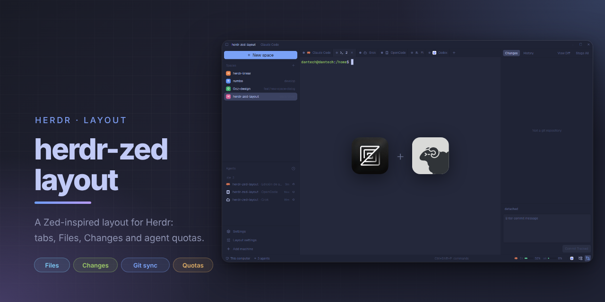

# Zed

A Herdr layout modeled on the Zed editor, in Tokyo Night colors. A slim title bar with breadcrumbs sits on top, a sidebar with a "New space" button, spaces and agents on the left, Zed-style flat tabs above the terminals, an optional Files/Changes panel on the right, and a status bar at the bottom with agent quota chips and the panel toggles.

## What you see

Top to bottom, the window is a column (`titlebar: none`, so the layout draws its own title bar):

1. **Title bar, 32px**, background `chrome` (`#1f2335`), 1px `border` line below, 12px text, draggable. Left: a sidebar toggle button (22px square, `mods/workspace-chrome/sidebar.svg`). Next to it, breadcrumbs separated by a dim `·`: the active space name (`foreground`), its git branch with a branch icon (`muted`), and the focused agent's program name, or the tab name if the tab was renamed (`muted`). Each crumb truncates at 240px. With no space it shows `Zed` in `muted`. On Windows/Linux, when the window reports buttons, minimize, maximize/restore and close sit on the right; close turns `blocked`-yellow on hover. On macOS the left padding grows to leave room for the traffic lights (`traffic_lights: [10, 8]`).
2. **Body**, a row with 1px `border` dividers:
   - **Sidebar, 300px** (min 44, max 560, resizable), background `chrome`, three stacked blocks:
     - **New space, 48px:** a full-width pill button (`solid` blue `#7aa2f7`, dark text, 8px radius) with a plus icon and the label "New space". The label hides when the sidebar is narrower than 160px.
     - **Spaces:** the shipped `spaces` mod, weight 1, min 90px.
     - **Agents:** the shipped `agents` mod, weight 1, min 90px.
   - **Work area**, a column:
     - **Tab strip, 34px**, `chrome` background. Each tab is flat with a 1px right border; the active tab uses the `background` color (`#24283b`) and `foreground` text, inactive tabs use `chrome` and `muted`. A new-tab `+` button (24px) is pinned at the right.
     - **Panes**: the active tab's terminals with no gap, no radius, a 1px `border` frame, and a 1px `accent` (`#7aa2f7`) frame on the focused pane.
   - **Right panel, 320px** (min 220, max 640, resizable), hidden until opened, `chrome` background. A stack with two views: **Files** (project tree of the focused terminal's folder; folders expand in place; selecting a file does not open it) and **Changes** (git panel: stage and commit tracked files, read-only history, a diff view for the selected file, and a Generate action that starts an installed agent).
3. **Status bar, 28px**, a row on `chrome`: the shipped `workspace-status` mod (flexible), then the **quota chips** (280px), then two **panel toggle icons** (64px, 24px buttons with 16px Lucide icons: `folder-tree` for Files, `git-compare` for Changes).

Fonts: terminal `JetBrains Mono` 14px with `[6, 8]` terminal padding; UI font `Geist`.

Colors come from the custom theme `tokyo-night` (`themes/tokyo-night.json`): background `#24283b`, foreground `#c0caf5`, chrome/canvas `#1f2335`, border `#1b1e2e`, hover `#292e42`, selected `#3b4261`, muted `#565f89`, dim `#414868`, accent/solid `#7aa2f7`.

## How it behaves

**Agent status** appears as an 8px dot at the left of each tab, using the theme's status colors: `working` `#7aa2f7`, `blocked` `#e0af68`, `done` `#9ece6a`, `idle` `#565f89`. A tab with no status gets the `dim` dot (`#414868`). The sidebar's spaces and agents lists show status in the shipped mods' own style.

**Quota chips** (status bar): one rounded chip per agent that reports usage, currently only Claude. It shows the agent name, then for each window (`5h`, `7d`) a 6px dot, the rounded percent used and the time to reset (`1h 40m`, `6d 14h`, `now`). The dot is `done` green below 70 %, `blocked` yellow from 70 %, `unknown` red from 90 %. Refreshes every 60 s. With no data source the chip is simply absent.

**Panel toggles** (status bar): clicking Files or Changes shows the right panel on that view; clicking the active one hides the panel. The active icon is `accent` blue on a `selected` background, the inactive one `ansi7`.

**Tabs**
- Show the agent's program icon (tinted icons follow the text color) and the tab name. Unnamed tabs (`tb<N>`) are labeled with the program name, or `Terminal`. A zoomed tab appends ` Z`.
- Click selects. Double-click renames (`tab.rename`). Press on one tab and release over another to reorder (`tab.move`). Right-click opens the shipped `menu` popup (200px wide) for that tab.
- Mouse wheel over the strip switches to the previous/next tab (`tab.prev` / `tab.next`).
- The active tab shows an 18px close button (`tab.close`). The `+` opens the shipped `new-menu` popup (250 x 512).

**Title bar**
- Sidebar button runs `layout.toggle {id: "sidebar"}`.
- Window buttons run `window.minimize`, `window.maximize`, `window.close`. Dragging the empty bar moves the window.

**New space dialog** (a 460 x 340 `dialog` overlay opened by the sidebar button):
- Fields: Folder (prefilled with the focused pane's cwd, or the home folder; empty on a remote machine), a `Browse…` chip (hidden for remote machines, uses `pickFolder`), Agent chips (`Terminal` plus every installed agent from `knownAgents`), and an optional Branch.
- `Tab` switches between Folder and Branch, `Enter` creates, `Esc` cancels. The focused field gets an `accent` border.
- Create with an empty folder (local) shows `Choose a folder.` in `blocked` color and does nothing else.
- No branch: runs `space.new` with `folder`, `machine` (if remote) and `argv` (the chosen agent's `run`). With a branch: opens the shipped `worktree` dialog (460 x 280) with `folder`, `machine`, `branch`, `argv`.
- If agents fail to load, "Could not load agents" appears next to the chips.

## Built from

`layouts/zed.json` node tree: `root` (column) → `titlebar` (block, 32px, `window_drag`), `body` (row) → [`sidebar` (column, 300px) → `new-space` (48px), `spaces`, `agents`], [`work` (column) → `tabs` (34px), `main` (block with `tab: "active"` and the `pane` style above)], [`panel` (column, 320px, `hidden: true`) → `panel-body` (stack, `active: "files"`) → `files`, `changes`], then `status` (row, 28px) → `status-main` (weight 1), `status-quota` (280px), `status-panels` (64px). Layout keys: `theme: "tokyo-night"`, `font`, `font_size`, `ui_font`, `background: "background"`, `terminal_padding`, `preview: "layouts/zed.svg"`.

Own mods (all `place: "none"`):
- `mods/zed-title` — title bar. Reads `theme()`, `window()`, `spaces()`, `agents()`, `focused()`, `layout()`; calls `run("layout.toggle")`, `run("window.minimize" | "window.maximize" | "window.close")`.
- `mods/zed-tabs` — tab strip. Reads `spaces()`, `panes()`, `theme()`; calls `run("tab.select" | "tab.rename" | "tab.move" | "tab.close" | "tab.prev" | "tab.next")`, `openOverlay({mod: "menu"})` and `openOverlay({mod: "new-menu"})`.
- `mods/zed-quota` — quota chips. Runs `sh -c 'cat "$HOME"/.claude/plugins/store/sub-meter_*.json'` every 60 s and parses `limits[]` (`kind`, `percentUsed`, `resetsAt`). Pure logic in `quota.js` with tests in `quota.test.js`.
- `mods/zed-panel-switch` — the two toggle icons. Calls `layout.select {stack: "panel-body", child}`, `layout.show {id: "panel"}` and `layout.hide {id: "panel"}`. Icons in `icons/` (Lucide, ISC, see `icons/NOTICE.txt`).
- `mods/zed-files`, `mods/zed-changes` — the panel views. `zed-files` lists folders with `sh` (`powershell` on Windows) and watches the folder with `watchFolder`; `zed-changes` runs `git` (status, diff, add, commit) in the focused terminal's folder, with tests for its planning logic.
- `mods/zed-new-space` — one mod, two roles: without `props().overlay` it renders the sidebar button; with it, the dialog. Uses `InputState`/`Input` from `gpui-base`, `knownAgents`, `pickFolder`, `home`, `panes`, `spaces`, `layout`, `openOverlay`, `closeOverlay`. Pure logic lives in `plan.js` (`planNewSpace`, `startingFolder`) with tests in `plan.test.js`. Its `mod.json` has `overlay: {width: 460, height: 340}`.

Shipped mods used: `spaces`, `agents`, `workspace-status`, `menu`, `new-menu`, `worktree`. Shipped assets used by path: `mods/workspace-chrome/{sidebar,branch,plus}.svg`, `mods/tabs/win-{min,max,restore,close}.svg`, `mods/pane/close.svg`.

Programs run: `git` (zed-changes), `sh`/`powershell` (zed-files folder listing) and one `cat` of the sub-meter file (zed-quota). No `hc`, no network. File access: the folder picker, the folders the user browses in the panel, and `~/.claude/plugins/store/sub-meter_*.json`.

Art: `layouts/zed.svg` is the layout's picker preview; `preview.png` is the screenshot for herdr.dev.

## Watch out

- Each mod ships its own `gpui-kit.d.ts` and `jsconfig.json` for editor typing. They are editor-only helpers and are optional for a fresh build.
- The theme `tokyo-night` is a custom file, not a shipped one. Without `themes/tokyo-night.json` the layout falls back to a different palette and the status dots lose their intended colors.
- `zed-title` assumes `traffic_lights` in the layout (`[10, 8]`) for macOS padding, and that window buttons only render when `window().buttons` is true.
- The close-button hover reuses the `blocked` color (yellow) as the danger color; there is no red in the title bar by design.
- Sidebar mods (`spaces`, `agents`) switch to a compact rail under 160px, and `zed-new-space` hides its label at the same threshold by reading the `sidebar` node's `size.px` from `layout()`. Toggling or resizing the sidebar through other means that don't change `size.px` won't hide the label.
- The branch field always hands off to the shipped `worktree` dialog; this layout never creates a checkout itself.
- The `−` / `□` / `❐` glyphs are used for the minimize/maximize/restore buttons on macOS and Linux; only Windows uses the shipped `win-*.svg` icons.
- Herdr does not serve SVG/PNG assets through symlinks, and caches a failed load per path. Copy assets as real files (the repo's `install.sh` does) and use a new file name if an icon silently fails to appear.
- The quota chip depends on the `sub-meter` Claude Code plugin. Codex reports `rate_limits` as `null` on free plans, and opencode and grok expose no quota, so they get no chip.
- It does not define `keys.json`; the title-bar toggle has no dedicated shortcut beyond the app's own `ctrl-shift-b`.

## Done when

- `herdr-app check` passes for every folder in `mods/`.
- `herdr-app do layout.switch '{"name":"zed"}'` shows the window described above, and `layout.error` is absent.
- The title bar shows `space · branch · agent` for the active space, and the sidebar button collapses and restores the sidebar.
- The tab strip shows one flat tab per tab of the active space, with a colored status dot; double-click renames, drag reorders, right-click opens the menu, wheel switches tabs.
- Clicking "New space" opens the dialog with the folder prefilled; Create with a folder runs `space.new`; Create with a branch opens the `worktree` dialog; an empty folder shows `Choose a folder.`.
- Clicking Files or Changes in the status bar opens the right panel on that view and clicking the active one closes it; the icons are visible against the bar.
- With the sub-meter plugin present, a Claude chip shows `5h` and `7d` percentages with reset times next to the panel icons.
- `node --test` passes for `mods/zed-new-space/plan.test.js`, `mods/zed-quota/quota.test.js`, `mods/zed-changes/plan.test.js` and `mods/zed-files/tree.test.js`.
